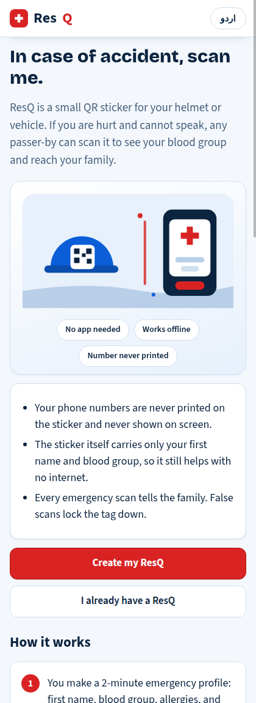
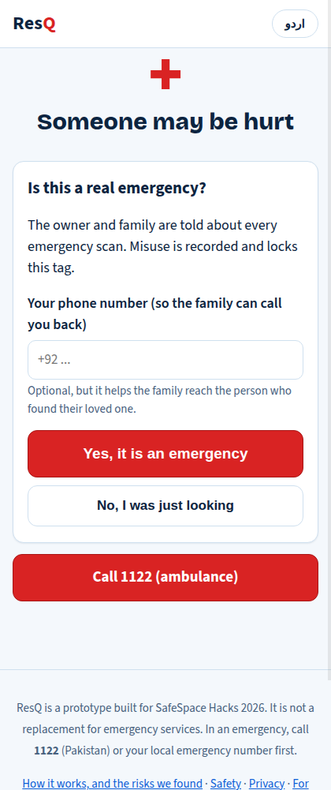
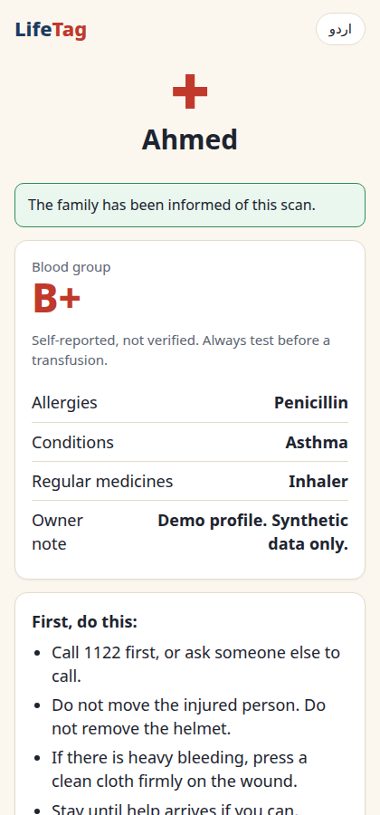
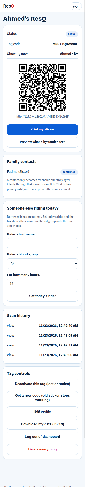
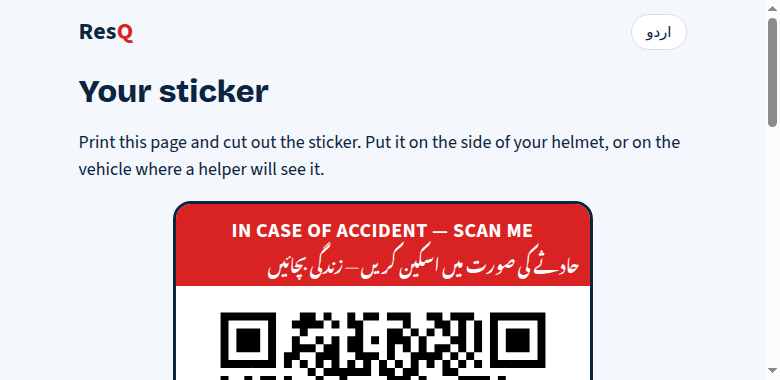
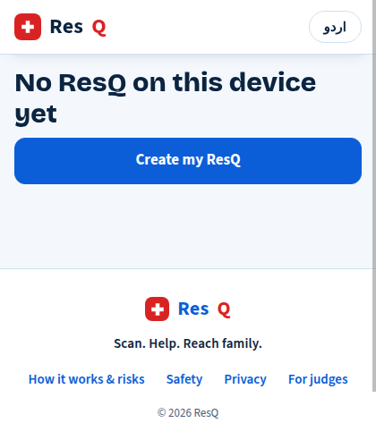

<p align="center">
  
</p>

<h1 align="center">ResQ</h1>

<p align="center"><b>In case of accident, scan me.</b></p>

<p align="center">
  A QR emergency sticker for a motorcycle helmet or vehicle. If the rider is hurt and cannot speak,
  any bystander can scan it to see the rider's blood group and reach their family in one tap.
</p>

<p align="center">
  <a href="https://daimx1214.github.io/resq/"><b>Live App</b></a> ·
  <a href="https://drive.google.com/file/d/1i81MQ481flqcpDqBmBggufC9ZSA-Rwpb/view?usp=drivesdk"><b>Watch the Demo Video</b></a> ·
  <a href="https://daimx1214.github.io/resq/#/t/KUWZCBA2H8WQ"><b>Try the Demo Tag</b></a> ·
  <a href="#screenshots">Screenshots</a> ·
  <a href="LICENSE">MIT License</a>
</p>

<p align="center">
  Built for <b>SafeSpace Hacks 2026</b> (Devpost), solo, by Daim Ali.
</p>

---

## Try it now

- **Demo video (72 seconds):** https://drive.google.com/file/d/1i81MQ481flqcpDqBmBggufC9ZSA-Rwpb/view?usp=drivesdk
- **Live app:** https://daimx1214.github.io/resq/
- **Demo tag (synthetic rider "Ahmed", blood group B+):** https://daimx1214.github.io/resq/#/t/KUWZCBA2H8WQ
- Scan the demo tag exactly as a bystander would: pass the emergency gate and you will see the blood group, allergy and condition info, and one-tap call buttons for two family contacts who each agreed to be listed. No phone number appears as text anywhere. That is the point.

ResQ is a mobile web app (PWA). It opens in the phone browser, can be added to the home screen, and a bystander needs to install nothing.

## The problem

In Pakistan, motorcycle accidents are an everyday event, and the first problem is rarely treatment. It is identity. An unconscious rider has no voice: nobody knows his blood group, his allergies, or who to call. Phones are locked. Wallets are missing. The golden hour is spent finding a name.

## How it works

**For the rider**

1. Create a 2-minute emergency profile: first name, blood group, allergies, conditions, medicines, and up to two family contacts. No CNIC, no home address, nothing else is ever asked.
2. Each family contact receives a personal consent link and agrees (or declines) themselves. Nobody is listed without agreeing.
3. Print the sticker and put it on the helmet or vehicle.

**For the bystander**

1. Scan the QR. First you meet an **emergency gate**: "Is this a real emergency?" Every emergency scan is logged and the owner can see it.
2. Behind the gate: the blood group in large type, allergies, conditions, medicines, one-tap **Call 1122** and **Call family** buttons, and a **Listen** button that plays recorded guidance in Urdu and English.
3. The sticker itself also carries the rider's first name and blood group as plain text inside the QR, so the two most vital facts work with no internet and no server at all.

**For the owner**

A dashboard with the tag's QR and status, scan history, today's-rider mode for borrowed bikes, one-tap deactivate, code regeneration, data download (JSON), and full delete.

## Safety of the design itself

Before building, we attacked the idea and wrote down 40 ways it could fail or be misused: sticker photographs used for "your son had an accident, send money" scams, prank scans panicking families, wrong self-reported blood groups, sequential tag numbers being scraped, borrowed bikes, stolen helmets, women's numbers being harvested, bystanders who fear police involvement, and more. The design answers each one it can, and states plainly what it cannot fix. The app's About page carries the full list ("How ResQ works, honestly").

Key answers, in short:

- **No phone number in the QR, on the sticker, or on the scan screen. Ever.** Numbers are used only inside call buttons, after the gate, and only for contacts who consented.
- Tag codes are **random 12-character strings**. Nothing sequential exists to scrape.
- Medical fields are labelled **"Self-reported, not verified. Always test before transfusion."** Empty fields display as **"Not provided. Treat as unknown"**, never as "none".
- Repeated "just looking" scans **lock the tag down**: the emergency path then needs a 3-second hold, and only the blood group and 1122 stay visible.
- First-aid guidance is deliberately minimal and conservative: call 1122 first, do not move the injured person, do not remove the helmet.
- Minimal data by design: first name, blood group, allergies, conditions, medicines, up to two contacts. No CNIC, no address, no date of birth.

## Features

- Emergency gate with scan logging and server-side lockdown (3 false reports in 24 hours)
- Consent-link flow: every family contact personally accepts, declines, or revokes
- Recorded Urdu and English voice guidance (works on phones with no Urdu TTS voice)
- Today's-rider mode, deactivate, regenerate code, data export, full delete
- English and Roman Urdu interface
- Dark mode, offline app shell (service worker), printable sticker
- Red, blue and white design system: the colours of emergency itself

## Screenshots

<table>
  <tr>
    <td align="center"><br><i>Landing, with the demo tag</i></td>
    <td align="center"><br><i>The bystander gate</i></td>
  </tr>
  <tr>
    <td align="center"><br><i>Emergency view: blood group, call buttons, no numbers</i></td>
    <td align="center"><br><i>Owner dashboard</i></td>
  </tr>
  <tr>
    <td align="center"><br><i>The printable sticker</i></td>
    <td align="center"><br><i>Footer</i></td>
  </tr>
</table>

_All screenshots use synthetic demo data._

## Tech

Plain HTML, CSS and JavaScript. No framework, no build step.

- **Frontend:** single-page app (`js/app.js`), self-hosted fonts (Bricolage Grotesque, Source Sans 3), service worker (`sw.js`) for the offline shell, PWA manifest with app icons.
- **Backend:** Firebase Authentication and Firestore under strict security rules: public tag data is readable only by its random code, listing is denied everywhere, contact numbers live in a separate record fetched only after the gate, consent records are writable only in their status field by the person holding the link, and the scan log is append-only for the public and readable only by the owner. A local on-device mode is kept as a fallback.
- **QR:** the library (`js/qrcode.js`, MIT, by Kazuhiko Arase) is vendored, so code generation works fully offline.
- **Hosting:** GitHub Pages.

## Run it locally

```bash
git clone https://github.com/Daimx1214/resq.git
cd resq
python3 -m http.server 8000
# open http://127.0.0.1:8000/
```

Without Firebase reachable, the app runs in local on-device mode automatically, which is enough to try every screen.

## Project structure

```
index.html            App shell, header, footer
css/                  Design system (Rescue Red, Blue and White)
js/app.js             All screens: landing, create, dashboard, print, scan, consent
js/store.js           Cloud (Firebase) and local data adapters
js/i18n.js            English and Roman Urdu strings
js/qrcode.js          Vendored QR library (MIT)
js/firebase-config.js Firebase web configuration
firestore.rules       Firestore security rules (the published copy)
icons/                App icons (red cross mark)
audio/                Recorded Urdu and English guidance
shots/                Screenshots used above
```

## Honest limitations of this prototype

- Contact numbers are protected by the unguessable tag code and are only fetched after the emergency gate; a determined technical attacker who already knows a code could query the database directly. The production design closes this with a small calling relay so numbers never leave the server.
- Alerts in this build are the scan log in the owner's dashboard plus the bystander's call buttons. SMS alerts need a paid gateway and are a roadmap item, not a claim.
- ResQ is a prototype. It is not a replacement for emergency services, and it says so on every screen.

## Credits

Designed and built by Daim Ali for SafeSpace Hacks 2026. All demo data in screenshots and tests is synthetic.

## License

[MIT](LICENSE), Copyright (c) 2026 Daim Ali. The vendored QR library is MIT, Copyright (c) 2009 Kazuhiko Arase.
